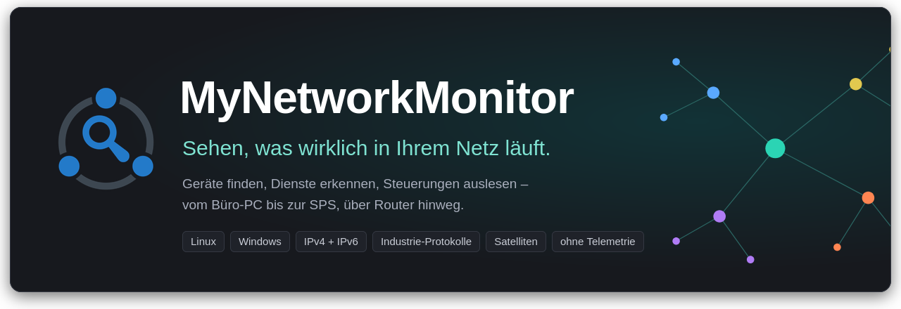
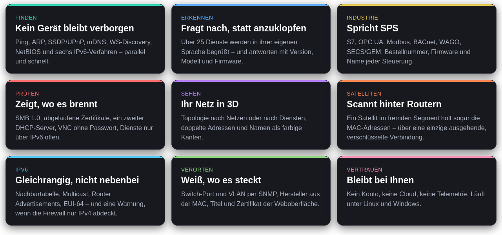
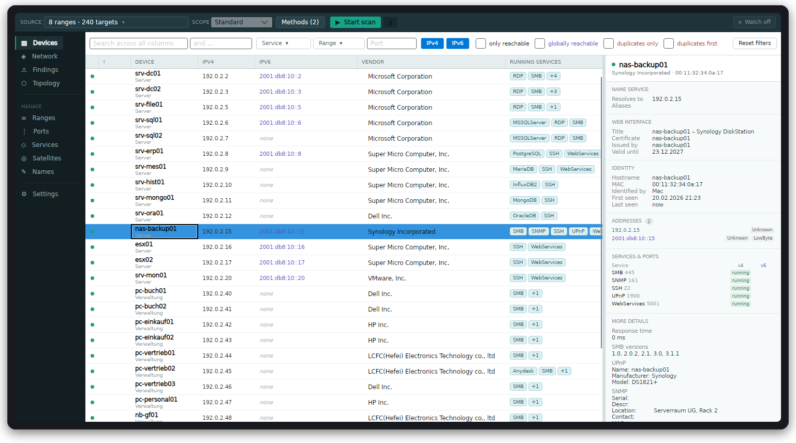
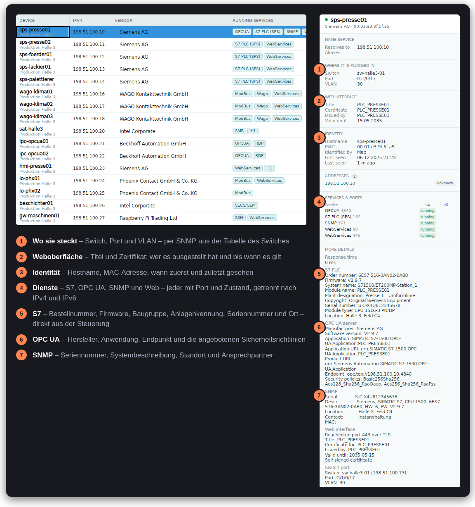
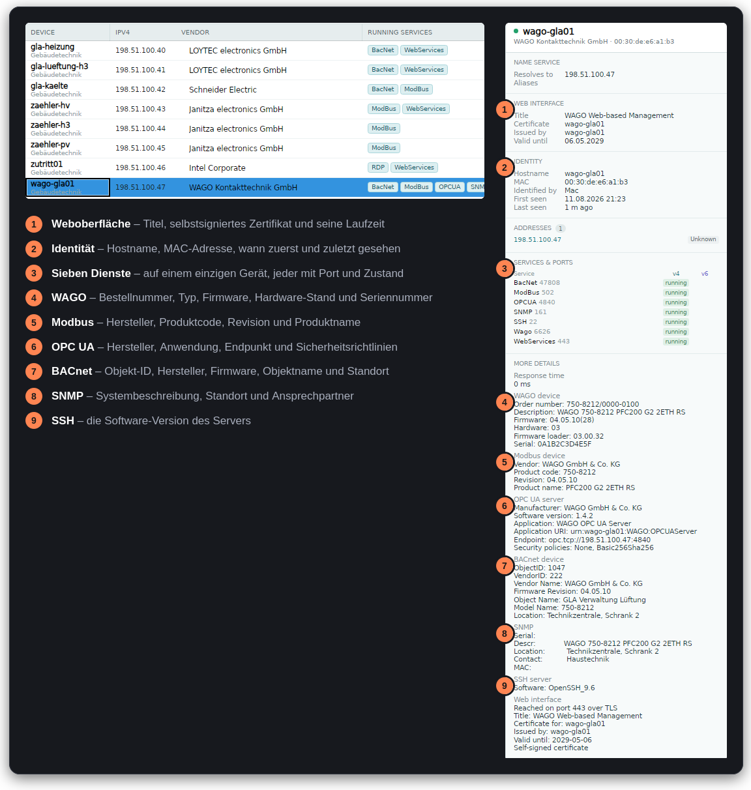
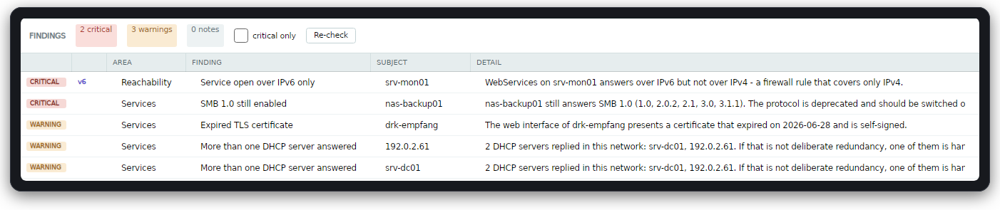
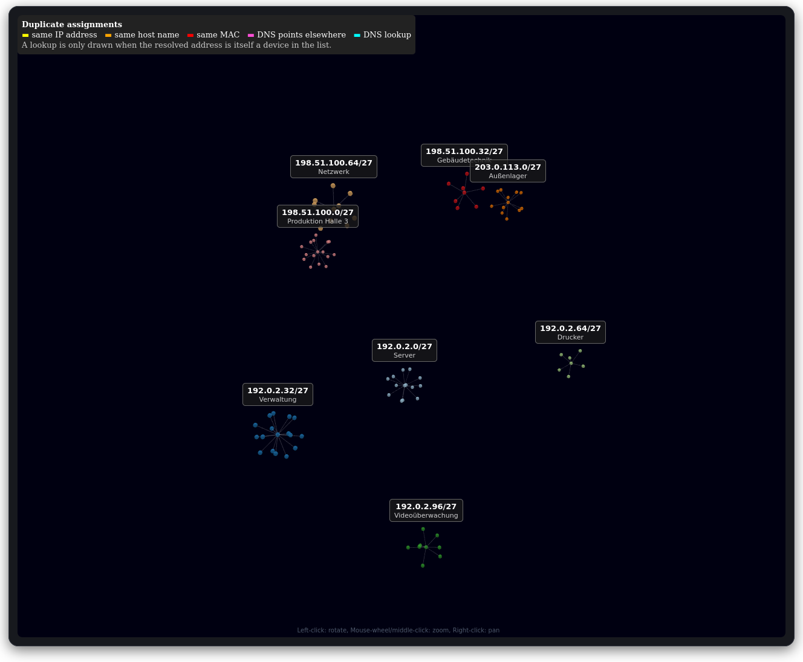
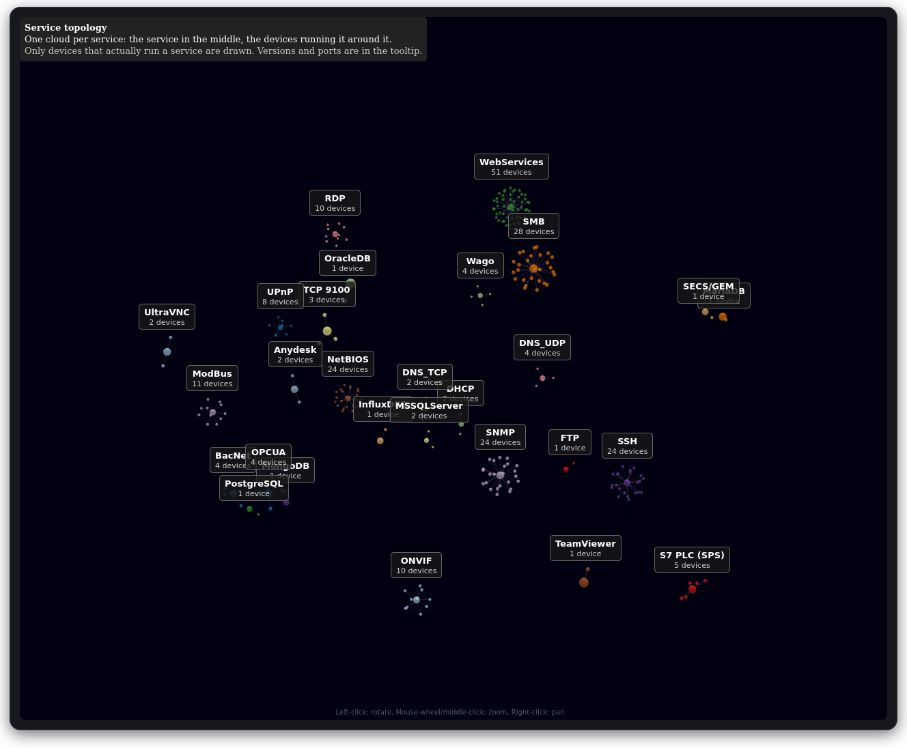
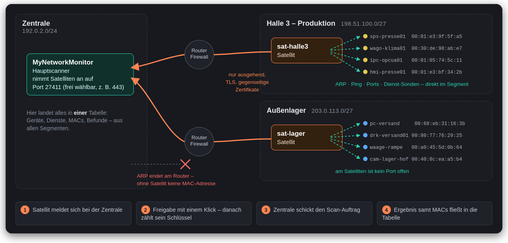
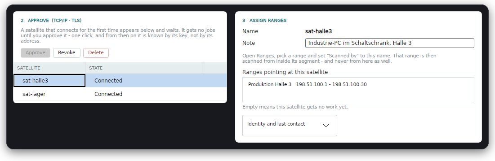

  

  
  
  
  
  

<h3 align="center">Ein Netzwerk-Scanner, der nicht nur anklopft, sondern nachfragt.</h3>

Vom Büro-PC bis zur SPS, vom Drucker bis zum OPC-UA-Server – auch hinter Routern.

---

## Für alle, die ihr Netz wirklich kennen wollen

Ein offener Port sagt wenig. Port 102 ist offen – aber welche Steuerung steckt dahinter, mit welcher Firmware, in
welcher Halle? Port 445 antwortet – aber spricht der Server noch SMB 1.0? MyNetworkMonitor beantwortet genau diese
Fragen. Es findet die Geräte, erkennt die Dienste, liest aus, was sie über sich verraten, und zeigt, wo etwas nicht
stimmt. Ohne Agent auf den Geräten, ohne Cloud, ohne Konto.

  

---

## Alles auf einen Blick

  

**Was Sie sehen:** ein Netz mit acht Bereichen und 93 Geräten nach einem Scan. Jede Zeile ein Gerät, mit Name,
Bereich, IPv4- und IPv6-Adresse, Hersteller (aus der MAC-Adresse) und den erkannten Diensten als Marken. Rechts die
Details des ausgewählten Backup-NAS: Weboberfläche mit selbstsigniertem Zertifikat, MAC-Adresse, beide Adressen, alle
Dienste mit Port und Zustand, die SMB-Versionen und was das Gerät per UPnP und SNMP über sich sagt. Darüber filtern Sie
nach Text, Dienst, Bereich, Port, IPv4/IPv6, Erreichbarkeit oder Dubletten.

---

## Er klopft nicht nur an – er fragt nach

Ein gewöhnlicher Portscan meldet „offen“ oder „zu“. MyNetworkMonitor schickt jedem Dienst die erste Nachricht
**in dessen eigener Sprache** – eine S7-Verbindung mit Abfrage der Systemzustandsliste, die OPC-UA-Frage nach den
Endpunkten, die Modbus-Geräteidentifikation, ein BACnet-ReadProperty, eine SMB-Verhandlung über alle Dialekte – und
die Anwendung antwortet von sich aus: mit Produkt, Version, Bestellnummer, Firmware. Diese Erkennungspakete sind
gezielt für jeden Dienst gebaut und an echten Geräten ausprobiert.

### Was eine S7-1500 alles verrät

  

**Was Sie sehen:** den Bereich „Produktion Halle 3“, die Steuerung `sps-presse01` ist ausgewählt. Rechts steht alles,
was MyNetworkMonitor von ihr erfahren hat – ohne Zugangsdaten, ohne Engineering-Software: an welchem Switch-Port und
in welchem VLAN sie hängt, das Zertifikat ihres Webservers, Bestellnummer, Firmware, Baugruppen- und Anlagenkennung,
Seriennummer und Einbauort aus der Steuerung selbst, dazu ihr OPC-UA-Server mit Endpunkt und den angebotenen
Sicherheitsrichtlinien und die SNMP-Angaben. Die Nummern führen durch die Abschnitte.

### Eine WAGO-Steuerung, fünf Protokolle

  

**Was Sie sehen:** eine Steuerung der Gebäudetechnik, die gleichzeitig über den WAGO-Dienst, Modbus TCP, OPC UA,
BACnet, SNMP, SSH und HTTPS erreichbar ist. Jedes Protokoll liefert seinen Teil: Bestellnummer und Seriennummer,
Produktcode, OPC-UA-Endpunkt, BACnet-Objektname und Standort. So sehen Sie auf einen Blick, über welche Wege eine
Anlage ansprechbar ist – und welche davon vielleicht niemand mehr braucht.

### Welche Dienste erkannt werden

| Bereich | Dienste |
|---|---|
| **Industrie und Gebäude** | Siemens S7 (102), OPC UA (4840), Modbus TCP (502), BACnet (47808/UDP), WAGO (6626), SECS/GEM (5000–5002, nur auf ausdrücklichen Wunsch) |
| **Datenbanken** | SQL Server mit SQL Browser, MySQL und MariaDB, PostgreSQL, Oracle, MongoDB, InfluxDB 2 |
| **Fernwartung** | RDP, VNC (mit Warnung bei Zugang ohne Passwort), TeamViewer, AnyDesk, RustDesk, BigFix Remote |
| **Infrastruktur** | DNS, DHCP, SSH, FTP, SMB 1.0 bis 3.1.1, SNMP, NetBIOS, Weboberflächen mit Titel und TLS-Zertifikat |
| **Per Rundruf** | SSDP/UPnP mit Gerätebeschreibung, mDNS, WS-Discovery, ONVIF-Kameras |

<b>Alle Verfahren zum Finden und Erkennen</b>

- **Geräte finden:** Ping (mit Schätzung des Betriebssystems aus der TTL), ARP-Anfrage und ARP-Tabelle, SSDP/UPnP,
  mDNS, WS-Discovery.
- **IPv6:** Nachbartabelle, Multicast-Ping, Router Advertisements, Multicast-Gruppen (MLD), Suche nach niedrigen
  Adressen, Ableitung aus bekannten MAC-Adressen (EUI-64).
- **Identifizieren:** Rückwärtsauflösung und Gegenprüfung im DNS, NetBIOS-Name und Arbeitsgruppe, SNMP (Name,
  Beschreibung, Standort, Kontakt, Seriennummer), ONVIF-Kameras, Switch-Port und VLAN über die Bridge-MIB der Switches.
- **Dienste prüfen:** TCP- und UDP-Ports bis hin zu allen 65 536, SMB-Versionen, Weboberfläche und Zertifikat, die
  Dienst-Sonden aus der Tabelle oben.
- **Hersteller** aus der MAC-Adresse, mit der öffentlichen Liste der IEEE-Kennungen; die Liste lässt sich im Programm
  erneuern.

Für empfindliche Netze lässt sich je Verfahren einstellen, dass nur Geräte gefragt werden, die schon in der Tabelle
stehen.

---

## Zeigt, wo es brennt

  

**Was Sie sehen:** die Befunde nach dem Scan, die kritischen zuerst. Ein Monitoring-Server antwortet über IPv6 auf
einem Port, den die Firewall nur für IPv4 sperrt. Ein NAS spricht noch SMB 1.0. Ein Drucker zeigt ein abgelaufenes
Zertifikat. Und im Verwaltungsnetz verteilt neben dem Domänencontroller ein zweites Gerät Adressen per DHCP – der
klassische falsch eingesteckte Router. Dazu kommen doppelte Adressen, Namen und MACs, DNS-Einträge, die woandershin
zeigen, und offene Ports auf Adressen, die aus dem Internet erreichbar sind.

---

## Ihr Netz in 3D

  

**Netzansicht:** Jeder Bereich ist eine eigene Wolke, beschriftet mit seinem Netz. Sie drehen, zoomen und verschieben
mit der Maus; über einem Gerät erscheinen Bereich, Name, Adresse und MAC. Doppelte Adressen, Namen oder MACs und abweichende
DNS-Einträge erscheinen als farbige Kanten zwischen den betroffenen Geräten.

  

**Dienstansicht:** dieselben Geräte, diesmal nach Diensten geordnet – in der Mitte jeder Wolke der Dienst, ringsum
die Geräte, auf denen er läuft, mit ihrer Anzahl. So fällt sofort auf, wo überall RDP offen ist, wie viele Geräte noch
SMB sprechen oder welche Steuerungen per OPC UA erreichbar sind. Beide Ansichten wählen Sie unter „Topology“ mit einem
Schalter.

---

## Satellitenbetrieb: ein Port nach draußen – volle Sicht nach drinnen

  

Hinter einem Router endet ARP – aus der Zentrale sehen Sie dort Adressen, aber keine MAC-Adressen und damit keine
Hersteller. Ein **Satellit** ist dasselbe Programm in einem anderen Segment, ferngesteuert von der Zentrale. Er
scannt sein Segment mit allen Verfahren, auch per ARP, und liefert das Ergebnis zurück; in der Zentrale steht alles in
einer Tabelle.

- **Nur ausgehend:** Der Satellit baut die Verbindung zur Zentrale auf. Am Satelliten ist kein Port offen; in der
  Firewall braucht es nur den Weg zum Port der Zentrale (Vorgabe 27411, z. B. auch 443).
- **Verschlüsselt und freigegeben:** TLS 1.2/1.3 mit Zertifikaten auf beiden Seiten. Ein neuer Satellit wartet, bis
  Sie ihn mit einem Klick freigeben; danach erkennt die Zentrale ihn an seinem Schlüssel und er sie an ihrem.
- **Mehrere Zentralen:** Ein Satellit kann für mehrere Hauptscanner arbeiten, etwa den Server und ein Notebook.
- **Dauerhaft:** unter Windows als Dienst, der mit dem Rechner startet; unter Linux, solange das Programmfenster offen ist.

  

**Was Sie sehen:** zwei freigegebene, verbundene Satelliten und rechts die Zuordnung: Der Bereich „Produktion Halle 3“
wird von `sat-halle3` gescannt, einem Industrie-PC im Schaltschrank.

---

## Loslegen

Fertige Pakete stehen unter [Releases](../../releases):

- **Linux:** `MyNetworkMonitor_v<version>_linux-x64.tar.gz` entpacken und `./einrichten.sh` ausführen – danach steht
  das Programm im Anwendungsmenü. AppImages brauchen FUSE 2 (Debian/Ubuntu: `sudo apt install libfuse2t64`,
  Fedora: `sudo dnf install fuse-libs`).
- **Windows:** `MyNetworkMonitor_v<version>_windows-x64.zip` entpacken und `MyNetworkMonitor.exe` starten.

Manche Verfahren (z. B. IPv6-Mitlesen) brauchen erweiterte Rechte; das Programm sagt dann, was fehlt.

> **Bitte nur Netze scannen, für die Sie die Erlaubnis haben.** Portscans und Abfragen können empfindliche Geräte wie
> Steuerungen stören – in Produktionsnetzen erst in einem ruhigen Moment und mit Rücksprache.

<b>Selbst bauen</b>

    ./publish.sh            # fragt nach Paketform und Ziel
    ./publish.sh linux      # ohne Rückfrage

Unter Windows dasselbe mit `.\publish.ps1` (z. B. `.\publish.ps1 windows`). Es führt vorher die Tests aus; die
Linux-Fassung entsteht dort als einzelne Programmdatei ohne AppImage.

Benötigt das .NET SDK 10. Die fertigen Programme liegen danach in `published/`.

<b>Wann das Programm ins Netz geht</b>

MyNetworkMonitor sendet keine Nutzungsdaten. Beim Start fragt es die Namensserver Ihres Netzes, ob es einen
Domänencontroller gibt (Erkennung eines Firmennetzes für den Lizenzhinweis) – nicht bei den Domänen, die Heimrouter
vergeben, und nie bei großen öffentlichen Diensten wie Google oder Cloudflare. Ins Internet geht es nur, wenn Sie es
auslösen: beim Erneuern der Herstellerliste (Datei von wireshark.org) und, wenn der Haken „library from CDN“ gesetzt
ist, beim Laden der 3D-Bibliothek.

---

## Lizenz

Eigene Lizenz, Quellcode einsehbar („Source Available“, `LICENSE`), kein Open Source:

- **Kostenlos** für Privatleute, Vereine ohne hauptberufliche Kräfte, Schulen, Hochschulen und
  gemeinnützige Einrichtungen.
- **Mit Lizenz:** Unternehmen, Selbständige und Behörden – für jede Nutzung, auch nur im eigenen Netz.
  Eine Lizenz gibt es auf Anfrage (Kontakt im Programm).
- Das unveränderte Programm darf kostenlos weitergegeben werden; verkaufen und veränderte Fassungen
  veröffentlichen ist nicht erlaubt.

Gefällt Ihnen das Programm, freut sich der Entwickler über eine Spende – der Knopf „Donate“ unten rechts im Programm.

Fremde Bestandteile und ihre Lizenzen: `THIRD-PARTY-NOTICES.md`.

**Haftung:** Bei kostenloser Nutzung wird die Software unentgeltlich und ohne Gewähr („wie sie ist“)
überlassen. Der Urheber haftet nur für Vorsatz und grobe Fahrlässigkeit, bei Verletzung von Leben, Körper
oder Gesundheit und nach dem Produkthaftungsgesetz; im Übrigen ist jede Haftung ausgeschlossen,
insbesondere für Datenverlust, entgangenen Gewinn, Ausfälle von Geräten oder Netzen und Folgeschäden.
Portscans und Abfragen können empfindliche Geräte wie Steuerungen stören – scannen Sie nur, wofür Sie die
Erlaubnis haben.

Alle Bilder zeigen ein erfundenes Netz: Adressen aus den Dokumentationsbereichen (RFC 5737, RFC 3849), die Domäne
`musterwerk.example`, erfundene Gerätenamen und Angaben. Herstellernamen stammen aus der öffentlichen Liste der
IEEE-Kennungen; Marken gehören ihren Inhabern. Schrift der Grafiken: Liberation Sans (SIL Open Font License).
